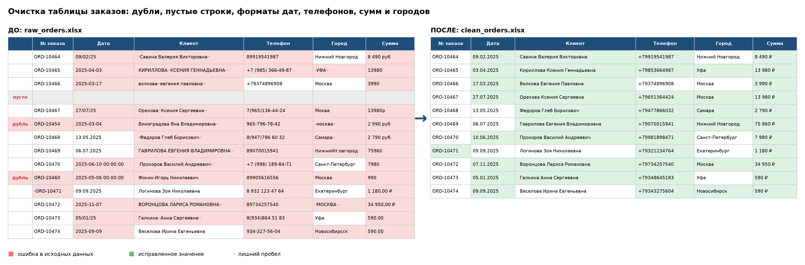
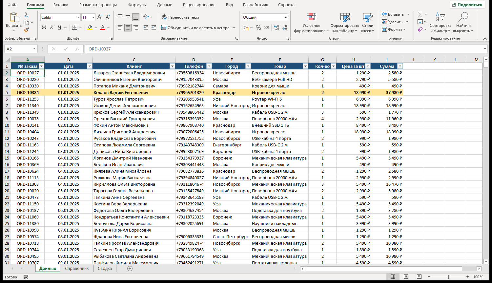
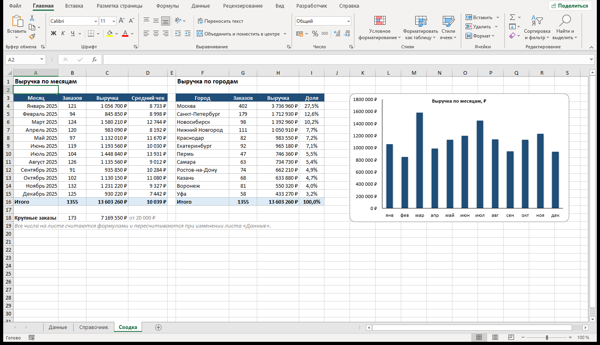

# Очистка «грязной» таблицы Excel

Скрипт на Python берёт неаккуратную выгрузку заказов интернет-магазина и превращает её в чистую таблицу Excel с формулами, сводкой и графиком.



## Исходная проблема

Таблица `raw_orders.xlsx` (1500 строк) собрана как типичная «ручная» выгрузка из нескольких источников:

- одни и те же заказы записаны по 2 раза, причём иногда в разном виде (другой формат даты, другой регистр);
- пустые строки и строки из одних пробелов;
- даты в разных форматах: `12.03.2025`, `2025-03-12`, `12/03/25` и настоящие даты Excel вперемешку;
- телефоны как попало: `+7 (912) 345-67-89`, `8 912 345 67 89`, `89123456789`, `912-345-67-89`, иногда числом или мусором («нет», «уточнить»);
- суммы текстом: `1 500 руб.`, `13 980,00 ₽`, `2990р`, `5490.00`;
- имена `ИВАНОВ ИВАН`, `иванов  иван` с лишними пробелами;
- города с опечатками и сокращениями: `Моква`, `Новосибирсск`, `НижнийН овгород`, `СПб`, `Питер`, `г. Москва`, `Екб`;
- количество вида `2 шт.`.

С такой таблицей нельзя работать: фильтр по городу находит не всё, суммы не складываются, даты не сортируются.

> Все данные вымышленные: сгенерированы библиотекой Faker, реальных людей и номеров здесь нет.

## Что делает скрипт

1. Убирает пустые строки и строки из одних пробелов.
2. Приводит каждую колонку к единому виду:
   - даты → настоящая дата Excel в формате `ДД.ММ.ГГГГ`;
   - телефоны → `+7XXXXXXXXXX`, некорректные номера → пустая ячейка;
   - суммы и количество → числа;
   - имена → `Иванов Иван Иванович`, без лишних пробелов;
   - города → название из справочника: сокращения по словарю, опечатки по похожести написания;
   - товары → точное название из справочника.
3. Удаляет дубли — и точные копии, и «скрытые», которые совпадают только после нормализации.
4. Проверяет результат: все ли даты и суммы распознаны, все ли города и товары есть в справочнике, сходится ли сумма с «количество × цена», нет ли одного номера заказа с разными данными.
5. Собирает `clean_orders.xlsx` и картинку `before_after.png`.

## Результат в цифрах

| | |
|---|---|
| Строк на входе | **1500** |
| Пустых строк удалено | **25** |
| Точных дублей удалено | **70** |
| Скрытых дублей удалено (тот же заказ в другом формате) | **50** |
| Строк в чистой таблице | **1355** |
| Исправлено ячеек | **5721** (в каждой из 1355 строк хотя бы одна ошибка) |
| даты (текст → дата) | 1085 |
| телефоны | 1175 |
| суммы (текст → число) | 1175 |
| имена клиентов | 735 |
| города | 704 |
| названия товаров | 511 |
| количество (текст → число) | 273 |
| номера заказов (пробелы, регистр) | 63 |
| Телефон не указан или некорректен (оставлен пустым) | 47 |
| Нераспознанных дат, сумм, городов, товаров | **0** |
| Расхождений с эталоном (см. «Проверка») | **0** |

Подробная статистика сохраняется в `cleaning_stats.json`.

## Что внутри clean_orders.xlsx

**Лист «Данные»** — чистая таблица: закреплённая шапка, автофильтр, даты в формате даты, суммы в рублях. Цена за штуку подтягивается **настоящей формулой ВПР** из справочника: `=ВПР(F2;Справочник!$A:$B;2;ЛОЖЬ)`. Крупные заказы (от 20 000 ₽) подсвечиваются **условным форматированием** — всей строкой.



**Лист «Справочник»** — товары, цены и категории. Если поменять цену здесь, она сразу изменится во всех заказах.

**Лист «Сводка»** — выручка, количество заказов и средний чек по месяцам и по городам, доля каждого города, крупные заказы и график. Все числа считаются формулами `СУММЕСЛИМН` / `СЧЁТЕСЛИМН` и пересчитываются при любом изменении данных.



## Проверка

- **Автотест по эталону** (`test_cleaning.py`). Генератор помнит, какими данные были до «загрязнения». Тест создаёт грязную таблицу, чистит её и сравнивает каждое поле каждого заказа с эталоном: все 1355 заказов совпадают по всем полям.
- **Формулы проверены в Microsoft Excel**: файл открыт и пересчитан в Excel, ошибок вроде `#Н/Д` нет ни в одной из 1435 формул. Итоги сводки по каждому месяцу и городу совпали с независимым расчётом в pandas до рубля (13 603 260 ₽ за год). Изменение суммы на листе «Данные» сразу меняет сводку, изменение цены в справочнике сразу меняет ВПР.

## Стек

- **Python 3.10+**
- **pandas** — обработка таблицы
- **openpyxl** — Excel-файл: формулы, форматы, условное форматирование, график
- **Faker** — генерация вымышленных данных
- **matplotlib** — картинка «до / после»

## Структура проекта

```
02_excel_cleaning/
├── generate_raw.py      # генерирует грязную таблицу raw_orders.xlsx
├── main.py              # запуск очистки: raw_orders.xlsx -> clean_orders.xlsx + before_after.png
├── cleaner.py           # правила очистки для каждой колонки
├── excel_report.py      # сборка Excel: листы, формулы, форматы, график
├── before_after.py      # картинка «до / после»
├── catalog.py           # справочники товаров и городов
├── test_cleaning.py     # автотест по эталонным данным
├── requirements.txt
├── raw_orders.xlsx      # исходная «грязная» таблица
├── clean_orders.xlsx    # результат
├── before_after.png     # результат
└── cleaning_stats.json  # статистика очистки
```

## Как запустить (пошагово)

1. Установите Python 3.10 или новее с [python.org](https://www.python.org/downloads/). На Windows при установке отметьте **«Add python.exe to PATH»**.
2. Откройте командную строку (Win + R → `cmd`) и перейдите в папку проекта:
   ```
   cd путь\к\папке\02_excel_cleaning
   ```
3. Создайте и включите виртуальное окружение — отдельную папку с библиотеками только для этого проекта:
   ```
   python -m venv .venv
   .venv\Scripts\activate
   ```
   (macOS / Linux: `source .venv/bin/activate`). В начале строки появится `(.venv)`.
4. Установите библиотеки:
   ```
   pip install -r requirements.txt
   ```
5. Запустите очистку:
   ```
   python main.py
   ```
   Через несколько секунд появятся `clean_orders.xlsx`, `before_after.png` и в консоли — отчёт с цифрами.

Дополнительно:

```
python generate_raw.py     # заново сгенерировать raw_orders.xlsx (получится та же таблица: сид фиксированный)
python test_cleaning.py    # проверить очистку по эталону
```

Чтобы почистить свою таблицу, положите её вместо `raw_orders.xlsx` с теми же названиями колонок: «№ заказа», «Дата заказа», «Клиент», «Телефон», «Город», «Товар», «Количество», «Сумма».
